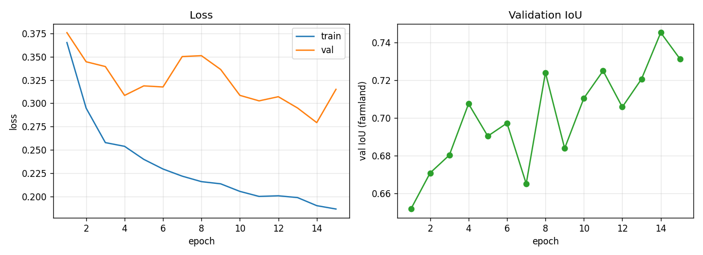
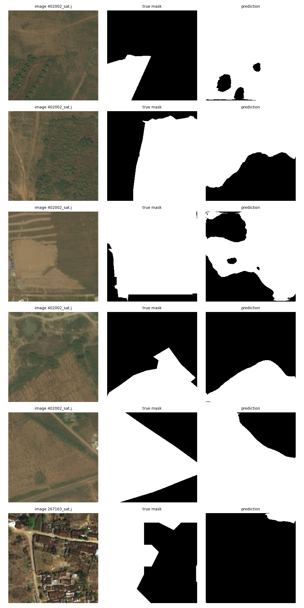

# Farmland Segmentation from Satellite Imagery (DeepGlobe)

Binary semantic segmentation: for each 256×256 satellite tile, label every pixel as
**farmland** or **not farmland**. Built as a Deep Learning course project with a free
Kaggle GPU (Tesla T4) and PyTorch.

## Results (test split, 121 images never used for training or tuning)

| model | loss | test IoU | test F1 / Dice | test accuracy |
|---|---|---|---|---|
| U-Net from scratch | cross-entropy | 0.7798 | 0.8763 | 0.8532 |
| U-Net + ResNet34 encoder (ImageNet) | cross-entropy | 0.8155 | 0.8984 | 0.8796 |
| U-Net + ResNet34 encoder | cross-entropy + Dice | 0.8140 | 0.8974 | 0.8755 |
| U-Net + ResNet34 encoder + augmentation | cross-entropy | **0.8196** | 0.9009 | 0.8799 |

All four runs use the same data, split, seed, batch size, learning rate and epoch count,
so the columns are directly comparable. IoU on the farmland class is the headline metric;
accuracy is reported only because it is conventional — with ~60% farmland pixels it flatters
a model that predicts "farmland" everywhere.

## Dataset

[DeepGlobe Land Cover Classification Dataset](https://www.kaggle.com/datasets/balraj98/deepglobe-land-cover-classification-dataset)
(803 labelled RGB satellite images with colour-coded masks).

The data is **not** in this repository: it is distributed under a research licence.
To reproduce, add the dataset to a Kaggle notebook ("Add data" → DeepGlobe Land Cover)
and it appears under `/kaggle/input/`.

The dataset ships 803 labelled pairs in `train/`; `valid/` and `test/` contain images
**without** masks, so the split in this project is made by us (see below).

### How the binary mask is built

`class_dict.csv` defines seven land-cover classes. Only one is our positive class:

| class | RGB |
|---|---|
| agricultural land | **(255, 255, 0)** |
| urban, rangeland, forest, water, barren, unknown | the other rows |

`farmland = (R,G,B) == (255,255,0)`, everything else → 0. Verified against a real mask:
95.9% of its pixels were `(255,255,0)`.

### Split and tiling

- Split **by image** (never by tile), fixed seed 42, 70/15/15 → **562 / 120 / 121** images.
- 2448×2448 images cut into non-overlapping **256×256** tiles → 9×9 = 81 tiles per image
  (partial edges dropped).
- Training used a subset: **120** train images (9,720 tiles) and **25** val images (2,025 tiles).
- Overall farmland share of the tiled data: **62.4%**.

## Repository layout

```
src/
  dataset.py    discovery, class_dict parsing, binary masks, split, 256 tiling, torch Dataset
  model.py      UNetSmall - baseline U-Net from scratch (7.7M params)
  losses.py     Dice loss and CE+Dice combination
  augment.py    random flips / 90-degree rotations (train split only)
  train.py      training loop: AMP, Adam, IoU/F1/OA, best checkpoint, curve, runs.csv
  evaluate.py   one-shot test evaluation + image/true/prediction figure
  check_env.py  environment and GPU sanity check
notebooks/      Kaggle notebook(s)
outputs/        figures (loss curves, sample predictions); checkpoints are git-ignored
data/           not committed (research licence) - see Dataset above
```

## How to run (Kaggle, GPU T4)

```bash
!mkdir -p /kaggle/working/src        # then write the src/*.py files there
!pip install -q segmentation-models-pytorch

# baseline U-Net, from scratch
!python /kaggle/working/src/train.py

# pretrained encoder
!HF_HUB_DISABLE_XET=1 python /kaggle/working/src/train.py resnet34

# CE + Dice
!HF_HUB_DISABLE_XET=1 python /kaggle/working/src/train.py resnet34 ce_dice

# with augmentation
!HF_HUB_DISABLE_XET=1 python /kaggle/working/src/train.py resnet34 ce_aug

# test evaluation (once, after training)
!python /kaggle/working/src/evaluate.py /kaggle/working/outputs/unet_resnet34_ce_best.pth
```

`train.py <model> <loss>` accepts `scratch|resnet34` and `ce|dice|ce_dice|ce_aug`.
`HF_HUB_DISABLE_XET=1` works around a Hugging Face download failure (HTTP 499) seen on Kaggle.

## Method summary

- **Baseline**: U-Net from scratch, 4 down / bottleneck / 4 up blocks, base width 32 (7,763,074 params).
- **Main model**: U-Net with a ResNet34 encoder pretrained on ImageNet (`segmentation-models-pytorch`).
- **Losses compared**: cross-entropy vs cross-entropy + Dice (equal weight).
- **Augmentation**: random horizontal/vertical flips and 90° rotations, applied to train tiles only.
- **Training**: Adam, lr 2e-4, batch 16, 15 epochs, mixed precision (fp16), seed 42.
  Only the best-so-far checkpoint is kept (highest val IoU).
- **Metrics**: IoU on farmland (primary), F1/Dice, overall accuracy, plus predicted-farmland
  share to detect a collapsed model.

## Figures

Validation curves for the best run (ResNet34 encoder + augmentation):



Predictions on the held-out test split — left: satellite tile, middle: true mask,
right: predicted mask:



## Limitations

- **Single seed, single split** — no error bars. Re-running the same configuration moved val IoU
  by ~0.01, so differences smaller than that are not meaningful.
- **Only 120 of 562** training images were used, and only **15 epochs** — the model is data-limited;
  it starts overfitting around epoch 11.
- **Coarse labels**: DeepGlobe masks are coarse polygons, so per-pixel IoU ~0.82 is close to the
  label ceiling rather than a limit of the model.
- **Augmentation's gain is within run-to-run noise** (+0.004 test IoU over the same model without it),
  so it should not be claimed as a real improvement on this evidence alone.
- **CE+Dice did not improve IoU** (−0.0015 test): it shifted the operating point toward recall
  (fewer missed farmland pixels, more false alarms) without a net gain.
- The validation subset (25 images) is small and its farmland share varies a lot between images
  (33–71%), which is why test IoU came out higher than val IoU.

## Future work

- Train on all 562 images for more epochs; expect the val/test gap to close.
- Multi-year change detection: register images from different years and predict farmland change,
  which also enables carbon-sequestration evaluation — explicitly out of scope here.
- Test stronger encoders (ResNet50, EfficientNet-B0) and heavier augmentation.
- Report mean ± std over 3 seeds to make the small differences trustworthy.

## Licence / data use

Code in this repository is for coursework. The DeepGlobe dataset is used under its research
licence and is not redistributed here; download it from Kaggle.
